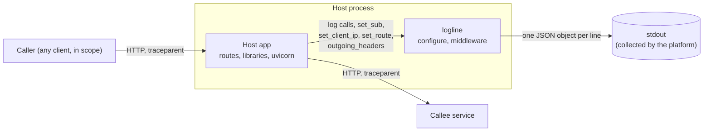
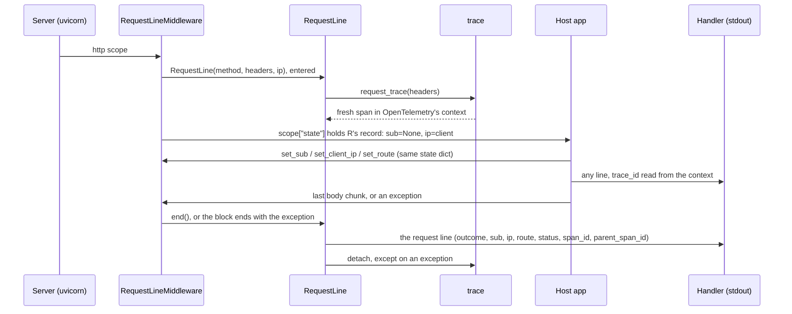

# logline architecture

## 1. Context and Scope

logline runs inside each host process of the fleet, with no server, storage or network of its own. Host
developers start at the [README](../README.md).

Outside: the callers, who choose their own `traceparent` and so their own `trace_id`; the callee services,
which receive the request's trace through `outgoing_headers()`; and the platform, which collects stdout.

## 2. Building Block View

The public modules are `logline`, `logline.check`, `logline.testing` and `logline.trace`; a name is public when
that module's `__all__` lists it. Every other module listed below is internal and may change in any release.

Module owners in `logline`:

- `configuration` owns `configure`: the root JSON handler on stdout, the root level from `LOG_LEVEL`, the
  `logline.request` level pin, the capped library loggers' levels (HTTP clients, `mcp`, `botocore` and
  `sqlalchemy.dialects.postgresql` at WARNING, `piper` at ERROR), the routing of uvicorn's loggers and the
  installing of the `process_failures` hooks, and OpenTelemetry's global propagator (see Constraints and reasons).
- `process_failures` owns the three hooks `configure` installs, `sys.excepthook`, `threading.excepthook` and
  `warnings.showwarning`, and the events they write: `process.crashed`, `thread.crashed` and
  `python_warning.raised`, with an `error_type`.
- `uvicorn_records` owns the filter `configure` puts on `uvicorn.error`: which uvicorn and websockets records it
  drops and which it names as `server_bind.failed`, `http_request.refused`, `asgi_app.failed`,
  `asgi_app.contract_broken`, `websocket_upgrade.refused` (a malformed upgrade that never reached the app) and the
  lifecycle events (`server_process.*`, `server_listen.started`, `server_shutdown.*`), with a `reason`, `status`,
  `task_count` or `error_type`. Every other record becomes `uvicorn.unknown_record`. Those names and codes are
  public (README, "Starting uvicorn").
- `standard` owns the machine rules of the logging standard, read from the package's `standard.json`: the base
  keys, the deny list of field names and suffixes (`is_denied_field`), the event-name pattern and the calls and
  assignments that are a host's own logging setup. No other module holds a copy of them.
- `check` owns the checker of those rules over one Python source: `check`, `Finding` and `Rule`. It parses text
  and never imports the checked code. It uses only the standard library and `standard`, no runtime module
  imports it, and an import contract and a test over its import statements hold both. It is public
  (`logline.check`): a host or the fleet's quality gate may import it.
- `record` owns the record shape: the processors that copy a standard-library record's scalar `extra=` fields
  first (never `event`, `exception` or `color_message`), keep only the scalar fields of a structlog event,
  render a non-finite float as `null`, then stamp `ts`, `level`, `service`, `version`,
  `logger` and `trace_id`, render exceptions as structlog's text traceback, and drop every field `standard`
  denies.
- `lifespan` owns the app startup and shutdown lines (`app_startup.completed`, `app_startup.failed`,
  `app_shutdown.completed`, `app_shutdown.failed`) on `logline.lifespan`: it runs the app's `lifespan` scope and
  writes them from the ASGI messages, under any server. `request`'s middleware dispatches to it.
- `websocket` owns how a WebSocket session ended, read from its ASGI messages: `outcome`, the answered `status` of an
  upgrade the app did not accept and the `close_code`. `request`'s middleware dispatches to it and writes the
  `websocket.ended` line with the per-scope record. It also marks the app's task, so the `uvicorn.error` filter can
  tell a refusal the session line carries from one that never reached the app.
- `asgi` owns the ASGI type aliases `request`, `lifespan` and `websocket` share.
- `request` owns the request line: `RequestLine`, the one writer of `request.ended` (the `method` coding, the
  outcome rule, the status when none was sent), which the middleware uses for HTTP and a host without ASGI uses
  directly; the per-request record in `scope["state"]`, which `RequestLine` wraps and which also feeds
  `websocket.ended`; and the functions that set `sub`, `ip` and `route`.
- `step` owns `Outcome`, the one owner of the `outcome` values and of the rule that an `Exception` reads `failed` and
  another `BaseException` `cancelled`, the stopwatch behind every `duration_ms`, and
  `StepTimer`, which writes a step's `.ended` line through the standard-library logger the caller names, so
  `record` shapes it like any library's line. `StepTimer` is also the one writer of a step's span: it asks `trace` for
  a child span when its block is entered, keeps that context for its line and drops a caller's `span_id` and
  `parent_span_id`.
- `testing` owns `configured`, the host tests' way to run `configure` and restore the logging state it
  changed, the three `process_failures` hooks and OpenTelemetry's global propagator included; it is the one module that reads
  `configuration`'s list of touched loggers.
- `trace` owns the trace of a request, of a WebSocket session and of a unit within it: it starts or continues it in
  OpenTelemetry's context from header pairs (ASGI byte pairs or text pairs, one extraction through the global
  propagator), reads `trace_id` from it
  and hands it on as headers or, for a message, as a `traceparent` value. It opens every span (request, session, a
  step's child span; a unit continues the sender's) and renders a span as the `span_id` and `parent_span_id` of
  a closing line, the one function every writer uses, with the key names `standard` reads from `standard.json`.

`record` uses `standard` and `trace`; `step` uses `standard` and `trace`; `trace` uses `standard`; `request` uses `step`, `trace`, `lifespan`, `websocket` and `asgi`; `uvicorn_records` uses `websocket`; `configuration` uses `record`, `uvicorn_records` and
`process_failures` and names the request logger; `testing` uses `configuration`.
`request` imports no web framework; an import contract keeps `logline` free of frameworks, servers and
HTTP clients.

## 3. Runtime View

A step inside the request runs the same way: `StepTimer` asks `trace` for a child span when its block is entered and
makes it current, so a nested step and an outgoing call name it; its line is written with that span attached, then
the previous span is put back, only if the step's span is still current. A callee that receives the call writes a
request line whose `parent_span_id` is the step's `span_id`, which is how the lines of one `trace_id` rebuild the
tree.

A host without ASGI, such as one on the standard library's `http.server`, takes the part of the middleware itself:
it enters `RequestLine` around its handler and calls `set_status` where it sends the status line, and writes its own
`.failed` line in `handle_error`, which runs after the block and so still inside the trace.

A `websocket` scope runs the same way: the middleware enters `request_trace(scope["headers"])` around the whole
session, so the app's lines, the server's error line and `websocket.ended` carry the session's trace. A turn on that
socket runs in `unit_trace(traceparent)` inside it: the same start or continue, but the trace is detached whenever
the block ends, an exception included, so the session's trace is current again and no later line of the socket
carries the turn's. A turn with a valid `traceparent` continues the sender's span instead of opening one, since
a unit has no line of its own to carry a fresh id. The request's trace stays attached after an exception because the
server's error line follows in the same task; a unit has no such line, so a host's handler line for a
failed turn carries the session's trace, not the turn's, unless the host logs it inside the block.

## 4. Deployment View

A library in the host's environment. The host installs it by a pinned git tag and calls `configure` at its
entry point; there is nothing of logline to deploy or run.

## 5. Crosscutting Concepts

**Trust.** The host and the libraries it loads are trusted; the lines go to stdout, which the platform
collects. A public caller is untrusted: it can set `traceparent`, which chooses the `trace_id` of its request's
lines and poisons correlation and no data, and it chooses the path and query, which logline never writes.
A log call's own `service`, `version` or `trace_id` field is overwritten, so `traceparent` reaches only
the `trace_id`. The host decides who the person and the client address are; logline writes
what it is told.

**Never logged.** At the default level and above, credentials, tokens, cookies, header values, contents, raw
paths and query strings stay out of every line logline writes or routes. At `LOG_LEVEL=debug`, other libraries'
DEBUG records pass as those libraries write them; some carry paths, query strings, header values or frames,
and logline neither masks nor caps them (see the [vision](VISION.md)). The mechanisms are the route template
instead of the path, text tracebacks without local variables, the HTTP client, `mcp`, `botocore` and
`sqlalchemy.dialects.postgresql` loggers at WARNING, `piper` at ERROR (it writes spoken text at WARNING) and the
filter on uvicorn's WebSocket lines and DEBUG records, which carry websockets' request headers and frames. An exception
message is logged as written: the log shows what happened, and a secret in a message is the app's defect.

**Proof strategy.** Runtime behaviour is proven through a real FastAPI app driven through the middleware
under a real `uvicorn.Server`, and `RequestLine` through a real `http.server.ThreadingHTTPServer` in a thread,
reading stdout; only the clock and randomness may be faked. Pure logic, such as
`check`, is proven by unit tests over source strings. Branch coverage is 100 %, measured over all tests. The
lowest direct dependency floors run the same tests.

## 6. Constraints and reasons

- `StepTimer` writes through the caller's standard-library logger and never goes through structlog: a library
  without `configure` still gets a plain record. It carries `error_type` and never the exception's message or
  a traceback; the layer where the exception stops writes those.
- The request line is written on its own logger at INFO, whatever `LOG_LEVEL` says: a quiet root must not
  hide the line that audits every request.
- The trace and the current span live only in OpenTelemetry's context, read through `opentelemetry-api`: a second
  contextvar could disagree with the first, and a worker thread inherits the one the framework copies. The span's
  parent id sits beside the span in that context, not in a store of logline's own.
- A step's line is written with the step's own context attached around the log call, so its `trace_id`,
  `span_id` and `parent_span_id` come from one trace wherever the block ends. The previous context is put back with
  `context.attach` only while the step's span is still current, never by detaching a token: a token from another
  context makes OpenTelemetry log "Failed to detach context" at ERROR.
- Steps inside an async generator keep their attach between two `yield`s, so a call the generator makes names the
  step; the consumer's steps between two `yield`s name it as parent, and a dropped generator's step stays the
  parent of the consumer's later steps until the unit ends. A consumer step around one `anext`, while the
  generator's step ends inside it, leaves the consumer's span stale until its own block ends.
- The lifespan lines, the crash lines and the `uvicorn_records` lines carry no span; the span keys belong to the
  lines that close a piece of work.
- `sub`, `ip` and `route` live in `scope["state"]`: the same dict reaches `BaseHTTPMiddleware`, Starlette's routing
  and the threadpool, where a contextvar set below `BaseHTTPMiddleware` would not reach the middleware.
- OpenTelemetry's global propagator is the one owner of the header rule. `configure` sets it to
  `TraceContextTextMapPropagator` while `OTEL_PROPAGATORS` is unset or empty, so a library that only calls
  `opentelemetry.propagate.inject` sends the same trace context as logline and no baggage is continued or
  forwarded anywhere in the process. A set variable is the operator's choice and `configure` leaves the global as
  OpenTelemetry built it; `trace` reads it on every call and follows it, so `none` gives every request and turn a
  new trace and no outgoing headers. A host that never calls `configure` keeps OpenTelemetry's default, trace
  context and baggage.
- `configure` puts a drop-all filter on `uvicorn.access`: a later `dictConfig` removes handlers but never
  filters, so the access log, which carries the raw path, stays silent in every start mode.
- The `uvicorn.error` filter knows a record by uvicorn's message template or by the `OSError` it logs for a bind
  failure, never by its formatted text, which carries host, port or the app's message. A record it does not know
  becomes `uvicorn.unknown_record` at its level, so a uvicorn upgrade that adds a template never leaks free text;
  only the app's exception keeps its traceback. Every read it makes of a record (`exc_info`, `args`) is total: a
  record that lacks what uvicorn normally supplies loses the field, never raises into uvicorn.
- The app startup and shutdown lines come from the `lifespan` scope the middleware already receives, because every
  ASGI server runs that scope through the app: no stack walk, no server-specific state. uvicorn's own four
  `app_*` templates and its "Exception in 'lifespan' protocol" record are dropped by equality, since the middleware
  writes what they said, with the traceback held at the `failed` send (`sys.exception()`). The middleware strips
  `message` from the `failed` answer it forwards, so no server logs the app's free text. What never reaches the
  app (a bind failure, a refused request, the server process lines, an app exception) stays template-mapped and
  uvicorn-only.
- A WebSocket session's line comes from the `websocket` scope the middleware already receives, so wsproto, which
  writes no refusal record, gets the same line. The middleware sets a context variable in the app's task and never
  resets it, because the server answers an unanswered or failed upgrade after the app has returned, in the same task.
  websockets-sansio writes its refusal synchronously in that task, so the filter drops the refusal when the variable is
  set and keeps it when it is not (a malformed upgrade is answered before any app task exists). uvicorn's older
  `websockets` implementation writes the refusal from the handler task, which the variable does not reach, so it
  writes the refusal beside the session line. websockets' `connection open`, its `connection closed` (also written when the handshake never produced a session or a
  refusal, a connection that never became a WebSocket) and uvicorn's two "without completing
  (or sending) handshake" records are dropped by equality; the session line says what the others said.
  The refusal is INFO, so `configure` opens `uvicorn.error` to INFO
  under a higher root level and the filter drops what the root level would drop after it has seen the refusal.
  `uvicorn.error` stays at INFO under `LOG_LEVEL=debug` too, so websockets' DEBUG frames never reach the filter.
- uvicorn's lifecycle records are named by their templates with the process id and address left out; the listening
  line has several templates (URL, IPv6 URL, unix socket, descriptor) and is known by its prefix. `.ended` is not
  used for them, because the standard reserves it for a timed step.
- `configure` takes over the root's handlers: one foreign stream handler would break "every line is one
  JSON object on stdout".

## 7. Not chosen

- Logging the request through uvicorn's access log: it writes the raw path with its query and has no `sub`.
  It reopens if uvicorn offers a structured line without the path.
- A framework-specific middleware per framework: one ASGI middleware serves every host.
- Reading the person and the address from headers inside logline: the host owns who the person is and whom
  it trusts as a proxy.

## 8. Risks and Technical Debt

- `route` is the host's template from `set_route`, else what the framework left in `scope["route"]`. An empty
  template logs `null`, with no fallback to the framework's route. logline never re-matches routes, hosts or
  paths, because a template it derived would carry raw values of parameterised
  mounts. Inside a mounted FastAPI app it is that app's own template, relative to the mount. FastAPI's router
  leaves it only for an `APIRoute`, so a `Mount` or a plain Starlette `Route` answering under FastAPI logs
  `null` unless the host calls `set_route`, as do an unmatched path and a gate that answered before the router.
  That the template is a literal pattern is the host's duty; logline cannot tell one from a path.
- `duration_ms` runs until the last body chunk, so a long streamed response logs when it ends and
  background work after the response is not counted; a client disconnect logs the status already sent, or 500 if none.
- A public client can choose its `trace_id`; stripping `traceparent` at the edge is the platform's.
- An exception that leaves a `RequestLine` block leaves the trace attached, as the middleware's does. A host that
  catches it outside the block and keeps the connection stacks the next request's trace on the stale one; the
  standard library closes the connection after `handle_error`.
- A WebSocket session gets `websocket.ended` when the app returns, not a request line; it runs in one trace from
  the upgrade to its end, which may last hours, and a call a host makes outside a turn carries that trace into the
  service it calls. A turn started with `unit_trace(None)` is not linked to the session's trace. uvicorn's legacy
  `websockets` implementation writes from another task and stays without a trace.
