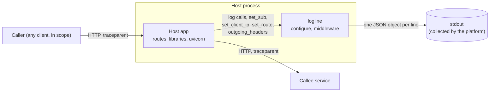
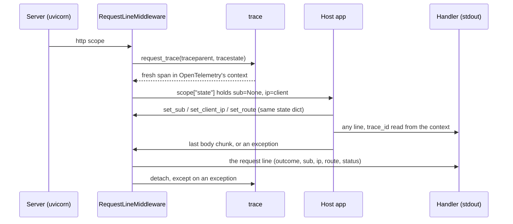

# logline architecture

## 1. Context and Scope

logline runs inside each host process of the fleet, with no server, storage or network of its own. Host
developers start at the [README](../README.md).

Outside: the callers, who choose their own `traceparent` and so their own `trace_id`; the callee services,
which receive the request's trace through `outgoing_headers()`; and the platform, which collects stdout.

## 2. Building Block View

Module owners in `logline`:

- `configuration` owns `configure`: the root JSON handler on stdout, the root level from `LOG_LEVEL`, the
  `logline.request` level pin, the capped library loggers' levels (HTTP clients, `mcp` and
  `sqlalchemy.dialects.postgresql` at WARNING, `piper` at ERROR), the routing of uvicorn's loggers and the filter
  on `uvicorn.error` that names uvicorn's failure records as `server_bind.failed`, `http_request.refused`,
  `asgi_app.failed`, `app_startup.failed` and `app_shutdown.failed`, with a `reason` or `error_type`. Those
  names and codes are public (README, "Starting uvicorn").
- `record` owns the record shape: the processors that copy a standard-library record's scalar `extra=` fields
  first (never `event`, `exception` or `color_message`), then stamp `ts`, `level`, `service`, `version`,
  `logger` and `trace_id`, and render exceptions as structlog's text traceback.
- `request` owns the request line, the per-request record in `scope["state"]` and the functions that set
  `sub`, `ip` and `route`.
- `step` owns `Outcome`, the one owner of the `outcome` values, the stopwatch behind every `duration_ms`, and
  `StepTimer`, which writes a step's `.ended` line through the standard-library logger the caller names, so
  `record` shapes it like any library's line.
- `testing` owns `configured`, the host tests' way to run `configure` and restore the logging state it
  changed; it is the one module that reads `configuration`'s list of touched loggers.
- `trace` owns the request's and the unit's trace: it starts or continues it in OpenTelemetry's context,
  reads `trace_id` from it and hands it on as headers or, for a message, as a `traceparent` value.

`record` and `request` use `trace`; `request` uses `step`; `configuration` uses `record` and names the request
logger.
`request` imports no web framework; an import contract keeps `logline` free of frameworks, servers and
HTTP clients.

## 3. Runtime View

A unit outside a request, such as a turn on a long-lived WebSocket, runs in `unit_trace(traceparent)` instead:
the same start or continue, but the trace is detached whenever the block ends, an exception included, so no
later line of the socket carries it. The request's trace stays attached after an exception because the
server's error line follows in the same task; a unit has no such line, so a host's handler line for a
failed turn falls outside the trace unless the host logs it inside the block.

## 4. Deployment View

A library in the host's environment. The host installs it by a pinned git tag and calls `configure` at its
entry point; there is nothing of logline to deploy or run.

## 5. Crosscutting Concepts

**Trust.** The host and the libraries it loads are trusted; the lines go to stdout, which the platform
collects. A public caller is untrusted: it can set `traceparent`, which chooses the `trace_id` of its request's
lines and poisons correlation and no data, and it chooses the path and query, which logline never writes.
A log call's own `service`, `version` or `trace_id` field is overwritten, so `traceparent` reaches only
the `trace_id`. The host decides who the person and the client address are; logline writes
what it is told.

**Never logged.** At the default level and above, credentials, tokens, cookies, header values, contents, raw
paths and query strings stay out of every line logline writes or routes. At `LOG_LEVEL=debug`, other libraries'
DEBUG records pass as those libraries write them; some carry paths, query strings, header values or frames,
and logline neither masks nor caps them (see the [vision](VISION.md)). The mechanisms are the route template
instead of the path, text tracebacks without local variables, the HTTP client, `mcp` and
`sqlalchemy.dialects.postgresql` loggers at WARNING, `piper` at ERROR (it writes spoken text at WARNING) and the
filter on uvicorn's WebSocket lines and DEBUG records, which carry websockets' request headers and frames. An exception
message is logged as written: the log shows what happened, and a secret in a message is the app's defect.

**Proof strategy.** The tests drive a real FastAPI app through the middleware under a real `uvicorn.Server`
and read stdout; only the clock and randomness may be faked. Branch coverage is 100 %, measured over all
tests. The lowest direct dependency floors run the same tests.

## 6. Constraints and reasons

- `StepTimer` writes through the caller's standard-library logger and never goes through structlog: a library
  without `configure` still gets a plain record. It carries `error_type` and never the exception's message or
  a traceback; the layer where the exception stops writes those.
- The request line is written on its own logger at INFO, whatever `LOG_LEVEL` says: a quiet root must not
  hide the line that audits every request.
- The trace lives only in OpenTelemetry's context, read through `opentelemetry-api`: a second contextvar
  could disagree with the first, and a worker thread inherits the one the framework copies.
- `sub`, `ip` and `route` live in `scope["state"]`: the same dict reaches `BaseHTTPMiddleware`, Starlette's routing
  and the threadpool, where a contextvar set below `BaseHTTPMiddleware` would not reach the middleware.
- `TraceContextTextMapPropagator` is used directly, never `opentelemetry.propagate`, so baggage and the
  `OTEL_PROPAGATORS` switch cannot change what the fleet propagates.
- `configure` puts a drop-all filter on `uvicorn.access`: a later `dictConfig` removes handlers but never
  filters, so the access log, which carries the raw path, stays silent in every start mode.
- The `uvicorn.error` filter knows a record by uvicorn's message template or by the `OSError` it logs for a bind
  failure, never by its formatted text, which carries host, port or the app's message. A record it does not
  know passes unchanged; the app's lifespan failure message, a traceback text Starlette sends, is one of them.
- `configure` takes over the root's handlers: one foreign stream handler would break "every line is one
  JSON object on stdout".

## 7. Not chosen

- Logging the request through uvicorn's access log: it writes the raw path with its query and has no `sub`.
  It reopens if uvicorn offers a structured line without the path.
- A framework-specific middleware per framework: one ASGI middleware serves every host.
- Reading the person and the address from headers inside logline: the host owns who the person is and whom
  it trusts as a proxy.

## 8. Risks and Technical Debt

- `route` is the host's template from `set_route`, else what the framework left in `scope["route"]`. An empty
  template logs `null`, with no fallback to the framework's route. logline never re-matches routes, hosts or
  paths, because a template it derived would carry raw values of parameterised
  mounts. Inside a mounted FastAPI app it is that app's own template, relative to the mount. FastAPI's router
  leaves it only for an `APIRoute`, so a `Mount` or a plain Starlette `Route` answering under FastAPI logs
  `null` unless the host calls `set_route`, as do an unmatched path and a gate that answered before the router.
  That the template is a literal pattern is the host's duty; logline cannot tell one from a path.
- `duration_ms` runs until the last body chunk, so a long streamed response logs when it ends and
  background work after the response is not counted; a client disconnect logs the status already sent, or 500 if none.
- A public client can choose its `trace_id`; stripping `traceparent` at the edge is the platform's.
- WebSocket connections get no request line; usage by a host with sockets decides what they get.
