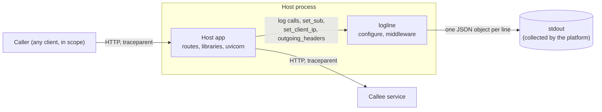
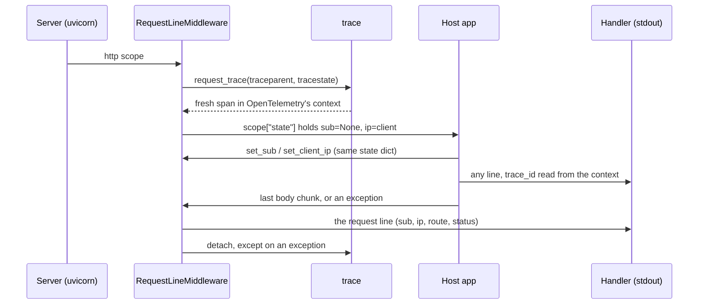

# logline architecture

## 1. Context and Scope

logline runs inside each host process of the fleet, with no server, storage or network of its own. Host
developers start at the [README](../README.md).

Outside: the callers, who choose their own `traceparent` and so their own `trace_id`; the callee services,
which receive the request's trace through `outgoing_headers()`; and the platform, which collects stdout.

## 2. Building Block View

Module owners in `logline`:

- `configuration` owns `configure`: the root JSON handler on stdout, the root level from `LOG_LEVEL`, the
  `logline.request` level pin, the HTTP client loggers' level and the routing of uvicorn's loggers.
- `record` owns the record shape: the processors that stamp `ts`, `level`, `service`, `version`, `logger` and
  `trace_id`, and render exceptions as text.
- `request` owns the request line, the per-request record in `scope["state"]` and the functions that set
  `sub` and `ip`.
- `trace` owns the request's trace: it starts or continues it in OpenTelemetry's context, reads `trace_id`
  from it and hands it on as headers.

`record` and `request` use `trace`; `configuration` uses `record` and names the request logger.
`request` imports no web framework; an import contract keeps `logline` free of frameworks, servers and
HTTP clients.

## 3. Runtime View

## 4. Deployment View

A library in the host's environment. The host installs it by a pinned git tag and calls `configure` at its
entry point; there is nothing of logline to deploy or run.

## 5. Crosscutting Concepts

**Trust.** The host and the libraries it loads are trusted; the lines go to stdout, which the platform
collects. A public caller is untrusted: it can set `traceparent`, which poisons correlation and no data, and
it chooses the path and query, which logline never writes. A caller cannot make a line carry its own
`service`, `version` or `trace_id`. The host decides who the person and the client address are; logline
writes what it is told.

**Never logged.** Credentials, tokens, cookies, header values, contents, raw paths and query strings stay out
of every line logline writes or routes. The mechanisms are the route template instead of the path, text
tracebacks of frames and exception types, without messages or locals, the HTTP client loggers at WARNING and
the filter on uvicorn's WebSocket lines and DEBUG records, which carry websockets' request headers and frames.

**Proof strategy.** The tests drive a real FastAPI app through the middleware under a real `uvicorn.Server`
and read stdout; only the clock and randomness may be faked. Branch coverage is 100 %, measured over all
tests. The lowest direct dependency floors run the same tests.

## 6. Constraints and reasons

- The request line is written on its own logger at INFO, whatever `LOG_LEVEL` says: a quiet root must not
  hide the line that audits every request.
- The trace lives only in OpenTelemetry's context, read through `opentelemetry-api`: a second contextvar
  could disagree with the first, and a worker thread inherits the one the framework copies.
- `sub` and `ip` live in `scope["state"]`: the same dict reaches `BaseHTTPMiddleware`, Starlette's routing
  and the threadpool, where a contextvar set below `BaseHTTPMiddleware` would not reach the middleware.
- `TraceContextTextMapPropagator` is used directly, never `opentelemetry.propagate`, so baggage and the
  `OTEL_PROPAGATORS` switch cannot change what the fleet propagates.
- `configure` puts a drop-all filter on `uvicorn.access`: a later `dictConfig` removes handlers but never
  filters, so the access log, which carries the raw path, stays silent in every start mode.
- `configure` takes over the root's handlers: one foreign stream handler would break "every line is one
  JSON object on stdout".

## 7. Not chosen

- Logging the request through uvicorn's access log: it writes the raw path with its query and has no `sub`.
  It reopens if uvicorn offers a structured line without the path.
- A framework-specific middleware per framework: one ASGI middleware serves every host.
- Reading the person and the address from headers inside logline: the host owns who the person is and whom
  it trusts as a proxy.

## 8. Risks and Technical Debt

- Under a Starlette `Mount`, the route template is the innermost route's, relative to the mount; the mount's
  `root_path` is never joined in.
- `duration_ms` runs until the last body chunk, so a long streamed response logs when it ends and
  background work after the response is not counted; a client disconnect logs the status already sent, or 500 if none.
- A public client can choose its `trace_id`; stripping `traceparent` at the edge is the platform's.
- WebSocket connections get no request line; usage by a host with sockets decides what they get.
